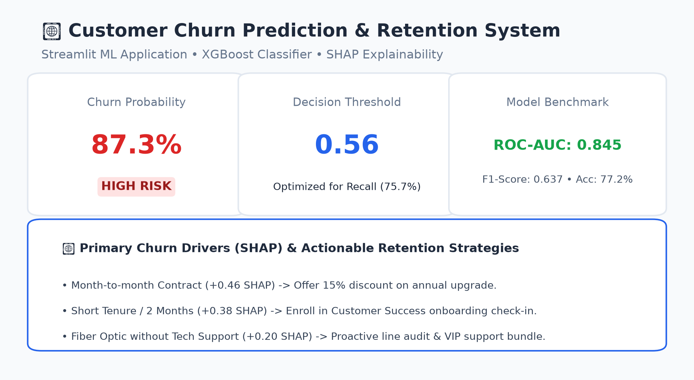
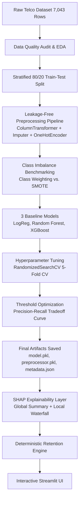
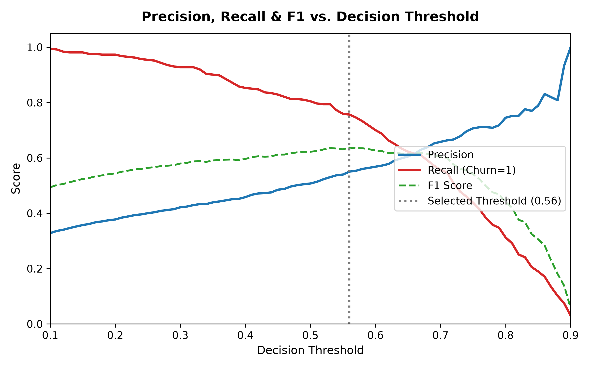
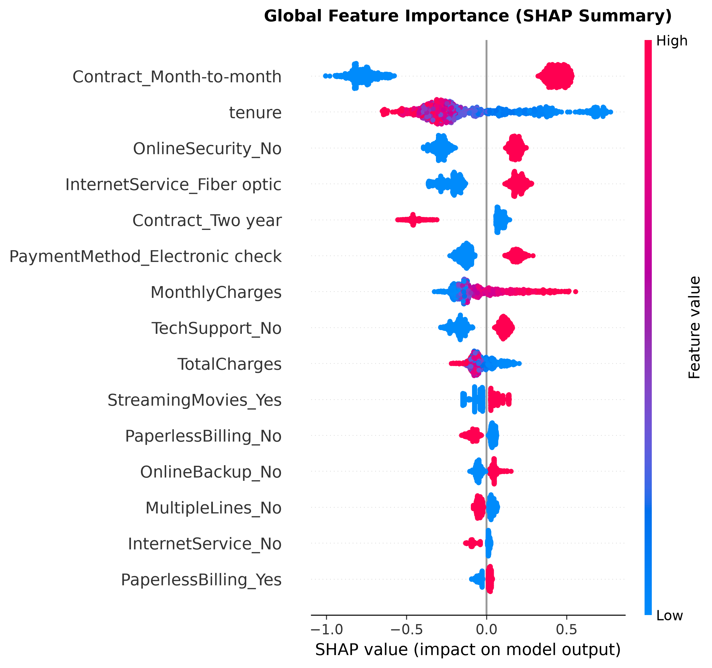

# 📊 Customer Churn Prediction & Retention System

[](https://www.python.org/)
[](LICENSE)
[](https://streamlit.io/)
[](https://xgboost.readthedocs.io/)
[](https://shap.readthedocs.io/)
[](tests/)

An end-to-end, production-style Machine Learning application designed to predict telecom customer churn probability, explain individual and global risk drivers via **SHAP (SHapley Additive exPlanations)**, and translate predictive scores into deterministic, prioritized business retention interventions.

---

## 🚀 Live Demo

- **Live Streamlit Web Application**: *[Streamlit Deployment Link Placeholder]*
- **GitHub Repository**: [https://github.com/madrimriganka-maker/Churn-Prediction-App](https://github.com/madrimriganka-maker/Churn-Prediction-App)



---

## 📌 Problem Statement

Customer churn represents one of the largest revenue leaks in subscription and telecommunications industries. Acquiring a new customer costs 5 to 7 times more than retaining an existing subscriber. 

Standard churn classification setups often fail in production because:
1. They evaluate models using raw accuracy on imbalanced data (predicting all non-churn achieves ~73.5% accuracy while losing 100% of at-risk revenue).
2. They apply an arbitrary decision threshold of `0.50` without considering asymmetry in business costs.
3. They output "black box" probabilities that customer success teams cannot translate into actionable retention outreach.

This project addresses these gaps with a full ML lifecycle: rigorous data quality auditing, leakage-free preprocessing, class imbalance experimentation, baseline comparisons across linear and ensemble architectures, hyperparameter optimization, threshold tuning, and granular SHAP interpretability.

---

## 📂 Dataset Architecture

The project uses the standard **Telco Customer Churn dataset** from Kaggle / IBM:
- **Total Records**: 7,043 telecom customers
- **Feature Count**: 21 raw attributes (3 continuous, 17 categorical, 1 identifier)
- **Target Variable**: `Churn` (Binary: `Yes` &rarr; `1`, `No` &rarr; `0`)
- **Class Balance**: 5,174 retained (73.46%), 1,869 churned (26.54%) &mdash; **~3:1 class imbalance**

### Data Quality & `TotalCharges` Anomaly Handling
- **Anomaly**: 11 customer records contained blank whitespace strings (`' '`) in `TotalCharges`.
- **Root-Cause Analysis**: All 11 records have `tenure == 0` and `Churn == 'No'`. These represent newly acquired customers who have not yet completed their first billing cycle.
- **Handling Strategy**: Blanks are parsed safely via `pd.to_numeric(errors='coerce')` and imputed with the training fold median inside an encapsulated scikit-learn `SimpleImputer` pipeline. This ensures 100% data integrity and guarantees zero runtime crashes on unexpected inference strings.

---

## 🏗️ System Architecture



---

## 🔍 Key EDA Findings

Empirical data analysis from `notebooks/01_eda.ipynb`:

1. **Contract Structure Dominates Risk**: Month-to-month subscribers experience a **42.7% churn rate**, compared to **11.3%** for One-year and **2.8%** for Two-year contracts. Month-to-month users represent **88.5% (1,655 / 1,869)** of all churn events.
2. **The First-Year Churn Cliff**: Customers in their first 12 months churn at **47.4%** (55.5% of all churn). After 24 months, churn drops to **21.6%**, decaying to **6.6%** beyond 5 years.
3. **Fiber Optic Service Vulnerability**: Fiber optic users churn at **41.9%** (double DSL's 19.0%), despite being the premium high-speed offering, indicating technical stability or pricing pain points.
4. **Pricing Threshold Sensitivity**: Churned customers pay an average of **$74.44/month** (median $79.65) versus **$61.27/month** (median $64.43) for retained customers.
5. **Support Bundles Anchor Retention**: Customers without online security or tech support churn at more than double the rate of customers enrolled in protection services.

---

## ⚙️ Methodology & Engineering

### 1. Leakage Prevention Preprocessing Pipeline
To guarantee zero test-fold and runtime leakage:
- Preprocessing is encapsulated in `sklearn.compose.ColumnTransformer`.
- Numerical features (`tenure`, `MonthlyCharges`, `TotalCharges`) are imputed with `SimpleImputer(strategy='median')` and scaled via `StandardScaler()`.
- Categorical features are encoded via `OneHotEncoder(handle_unknown='ignore', sparse_output=False)` with zero manual pre-split dummy variable creation.
- Preprocessor is fitted strictly on the 80% training split.

### 2. Class Imbalance Handling Comparison
Imbalance strategies were benchmarked strictly on the training partition:
- **Approach A (Cost-Sensitive Class Weighting)**: `class_weight='balanced'` / `scale_pos_weight`.
- **Approach B (SMOTE Resampling)**: Synthetic Minority Over-sampling applied exclusively to training fold.

| Imbalance Strategy | Val ROC-AUC | Val Recall (Churn=1) | Val F1-Score | Decision |
| :--- | :---: | :---: | :---: | :--- |
| **Approach A: Class Weighting** | **0.8483** | **0.7993** | **0.6331** | **Selected** (Higher AUC, preserves distributions) |
| **Approach B: SMOTE (Train-Only)** | 0.8482 | 0.7759 | 0.6322 | Rejected (Marginally lower recall, adds synthetic noise) |

---

## 📊 Model Evaluation & Baseline Comparison

Three models were evaluated on the held-out, untouched test set (1,409 customers, 20% stratified test split):

| Model | ROC-AUC | Precision | Recall (Churn=1) | F1-Score | Accuracy |
| :--- | :---: | :---: | :---: | :---: | :---: |
| **XGBoost (Baseline)** | **0.8425** | 0.5178 | 0.7781 | 0.6218 | 0.7488 |
| **Logistic Regression** | 0.8414 | 0.5034 | 0.7834 | 0.6130 | 0.7374 |
| **Random Forest** | 0.8411 | 0.5140 | **0.7861** | 0.6216 | 0.7459 |

### Hyperparameter Tuning (XGBoost)
XGBoost was tuned using 5-fold Stratified Cross-Validation (`RandomizedSearchCV`, 20 iterations, scoring=`roc_auc`):
- **Optimal Hyperparameters**: `n_estimators=75`, `max_depth=3`, `learning_rate=0.05`, `subsample=0.9`, `colsample_bytree=0.7`, `min_child_weight=1`, `gamma=0.1`.
- **Tuned Test ROC-AUC**: **0.8452**

---

## 🎯 Threshold Optimization & Why Recall Matters

In telecommunications customer retention:
- **False Negative (FN)**: Model predicts a customer will stay, but they churn. **Business Cost**: Loss of entire Customer Lifetime Value (LTV ~$1,200+).
- **False Positive (FP)**: Model predicts a customer will churn, but they stay. **Business Cost**: Cost of a proactive check-in or discount incentive (~$15–$30).

Because missing a churner is ~40x to 80x more damaging than an unnecessary retention contact, the decision threshold was evaluated across the range `[0.10, 0.90]`.



- **Selected Operating Threshold**: **`0.56`**
- **Test Performance at Operating Threshold**:
  - **ROC-AUC**: **0.8452**
  - **Recall (Churn=1)**: **75.67%** (Captures over 3 in 4 churners)
  - **Precision**: **55.06%** (High marketing efficiency)
  - **F1-Score**: **0.6374**
  - **Accuracy**: **77.15%**

---

## 🔍 Explainability (SHAP)

SHAP translates complex model predictions into game-theoretic attribution scores.

### Global Explanations
Global feature importance across test customers reveals the primary systemic churn drivers:



1. `Contract_Month-to-month`: Single strongest positive driver of churn.
2. `tenure`: Strongest protective feature against churn.
3. `InternetService_Fiber optic`: Consistently elevates churn risk.
4. `PaymentMethod_Electronic check`: Associated with higher churn propensity.
5. `OnlineSecurity_No` & `TechSupport_No`: Substantially increase attrition probability.

### Dynamic Local Explanations
For each prediction in the Streamlit UI, a dynamic SHAP **waterfall plot** decomposes the exact contribution of each feature to that customer's score relative to the expected base value.

---

## 💡 Retention Recommendation Engine

Predictions are mapped to deterministic, explainable business interventions prioritizing top SHAP drivers:

| Top SHAP Risk Driver | Empirical Condition | Recommended Retention Intervention | Priority |
| :--- | :--- | :--- | :--- |
| **Month-to-month Contract** | `Contract == 'Month-to-month'` | Offer targeted 15% discount for upgrading to 1- or 2-year commitment. | **High** |
| **Low Customer Tenure** | `tenure < 12 months` | Enroll in Customer Success onboarding check-in and 90-day warranty. | **High** |
| **High Monthly Charges** | `MonthlyCharges > $70` | Audit plan features; offer bundle discounts or trim unused services. | **Medium** |
| **Fiber Optic Service** | `InternetService == 'Fiber optic'` | Proactive line stability diagnostic; router satisfaction check. | **Medium** |
| **Missing Tech Support** | `TechSupport == 'No'` | Offer 3 months complimentary VIP technical support bundle. | **Medium** |
| **Electronic Check Payment** | `PaymentMethod == 'Electronic check'` | Incentivize credit card / bank autopay with a one-time $10 bill credit. | **Low** |

---

## 📂 Project Structure

```text
churn-prediction-app/
├── data/
│   ├── raw/
│   │   └── WA_Fn-UseC_-Telco-Customer-Churn.csv
│   └── processed/
├── notebooks/
│   └── 01_eda.ipynb              # Executable end-to-end EDA notebook
├── src/
│   ├── __init__.py
│   ├── preprocessing.py          # Leakage-free ColumnTransformer pipeline
│   ├── train.py                  # Reproducible training & tuning pipeline
│   ├── evaluate.py               # Metrics & threshold optimization
│   ├── explain.py                # SHAP waterfall & recommendation engine
│   └── utils.py                  # Schema definitions & serialization
├── models/
│   ├── preprocessor.pkl          # Serialized scikit-learn pipeline
│   ├── churn_model.pkl           # Serialized tuned XGBoost model
│   └── model_metadata.json       # Performance metrics & threshold specs
├── app/
│   ├── app.py                    # Interactive Streamlit application
│   └── assets/
│       ├── shap_summary.png      # Global SHAP summary plot
│       ├── threshold_optimization.png
│       └── app_screenshot.png    # Dashboard preview mockup
├── tests/
│   ├── __init__.py
│   ├── test_preprocessing.py     # Pipeline & leakage validation tests
│   ├── test_model.py             # Inference range & artifact tests
│   └── test_app_logic.py         # Threshold, risk tier & recommendation tests
├── .streamlit/
│   └── config.toml               # Streamlit deployment configuration
├── requirements.txt
├── .gitignore
├── LICENSE
└── README.md
```

---

## 💻 How to Run Locally

### 1. Clone Repository & Setup Environment
```bash
git clone https://github.com/madrimriganka-maker/Churn-Prediction-App.git
cd Churn-Prediction-App

# Create virtual environment (Python 3.10+)
python3 -m venv .venv
source .venv/bin/activate  # On Windows: .venv\Scripts\activate

# Install dependencies
pip install -r requirements.txt
```

### 2. Reproduce the Training Pipeline
```bash
export PYTHONPATH=.
python src/train.py
```
*Outputs: Rebuilds models, re-tunes hyperparameters, optimizes threshold, and saves assets to `models/` and `app/assets/`.*

### 3. Run Automated Tests
```bash
pytest -v tests/
```
*Executes all 12 unit and integration tests across preprocessing, model inference, and application logic.*

### 4. Launch Streamlit Application
```bash
streamlit run app/app.py
```
*Open your browser at `http://localhost:8501` to use the interactive dashboard.*

---

## ☁️ Deployment (Streamlit Community Cloud)

1. Fork or push this repository to GitHub.
2. Visit [share.streamlit.io](https://share.streamlit.io/) and log in with your GitHub account.
3. Click **New app**.
4. Select repository: `madrimriganka-maker/Churn-Prediction-App`, branch `main`, and main file path: `app/app.py`.
5. Click **Deploy**. All dependencies in `requirements.txt` and model artifacts in `models/` will load automatically.

---

## ⚠️ Limitations & Real-World Considerations

- **Historical Observational Data**: SHAP reveals correlation and feature contribution within the model, not necessarily causal relationships. Causal validation requires randomized retention A/B tests.
- **Rule-Based Recommendations**: Business recommendations are deterministic heuristics. In enterprise production, recommendations should feed into an uplift modeling engine.
- **Data Drift**: In production, consumer macroeconomics, competitor pricing, and network upgrades require periodic drift detection (e.g. Evidently AI) and scheduled model retraining.

---

## 🔮 Future Enhancements

- **Uplift Modeling**: Predict which customers are "persuadable" vs "sure things" to optimize retention spend efficiency.
- **Real-Time CRM Webhook**: Connect Streamlit predictions directly to Salesforce / HubSpot / Zendesk APIs.
- **Continuous Monitoring**: Integrate MLflow for experiment tracking and Evidently for population stability index (PSI) tracking.

---

## 📄 License

This project is licensed under the MIT License - see the [LICENSE](LICENSE) file for details.
